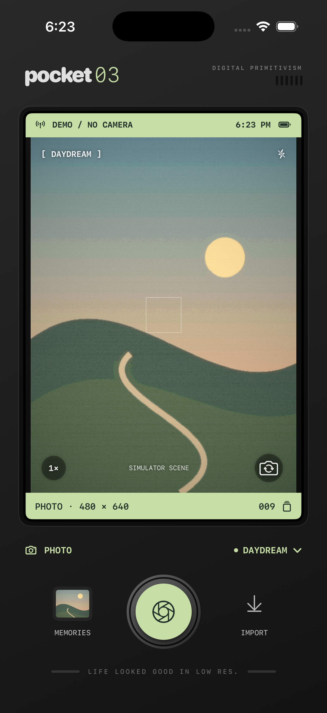

# Pocket03

A native iPhone camera for small, imperfect memories. SwiftUI + AVFoundation + Core Image. iOS 17+, no external dependencies, accounts, analytics or network services.



## Features

- Live portrait 480 × 640 processing with four original treatments: Daydream, After Hours, Candy CCD and Mono 01.
- Adjustable effect strength, highlight bloom, posterization, luminance grain, row banding and vignette.
- Photo capture, front/back camera, torch and 1–4× digital zoom (hardware permitting).
- Import a photo through Apple's picker, respecting image orientation.
- Record filtered **silent** H.264 movies. Audio is intentionally absent and labeled in the camera and gallery.
- Persistent local gallery, native sharing and explicit save to Photos.
- A labeled generated landscape on the simulator; the physical iPhone uses its camera.

## Run

Open `Pocket03.xcodeproj` in Xcode, choose an iPhone simulator and Run. The project is checked in; XcodeGen is needed only after changing `project.yml`.

For a physical iPhone, choose your device and set your Apple development team in **Signing & Capabilities**. If necessary, change `studio.pocket03.camera` to a unique bundle ID. Enable Developer Mode on the phone and Run. No team or signing identity has been configured by this project.

```sh
# Regenerate only if changing project.yml
xcodegen generate
# Simulator build
xcodebuild -project Pocket03.xcodeproj -scheme Pocket03 \
  -destination 'platform=iOS Simulator,name=iPhone 17 Pro' \
  -derivedDataPath build CODE_SIGNING_ALLOWED=NO build
# Unit/integration and UI tests
xcodebuild -project Pocket03.xcodeproj -scheme Pocket03 \
  -destination 'platform=iOS Simulator,name=iPhone 17 Pro' \
  -derivedDataPath build CODE_SIGNING_ALLOWED=NO test
```

## Reverse engineering boundary

See [docs/reconstruction.md](docs/reconstruction.md). This is a new implementation informed by static observations from 0.3MP Camera Android 1.5.12, not recovered original source or an exact reproduction of its protected filter. No original brand artwork, model, native libraries or GLSL snippets are bundled.

## Validation

The project has simulator integration coverage for all treatment dimensions, zero-strength color preservation, bounded grain, EXIF rotation, photo persistence, corrupt-index protection, portrait silent-video output, and the photo → gallery → video → relaunch UI flow. Physical camera exposure, front-camera mirroring, torch, on-device performance, Photos permissions and external sharing need an actual iPhone check. The Photos picker selection gesture was not automated. App Store distribution is not configured.
