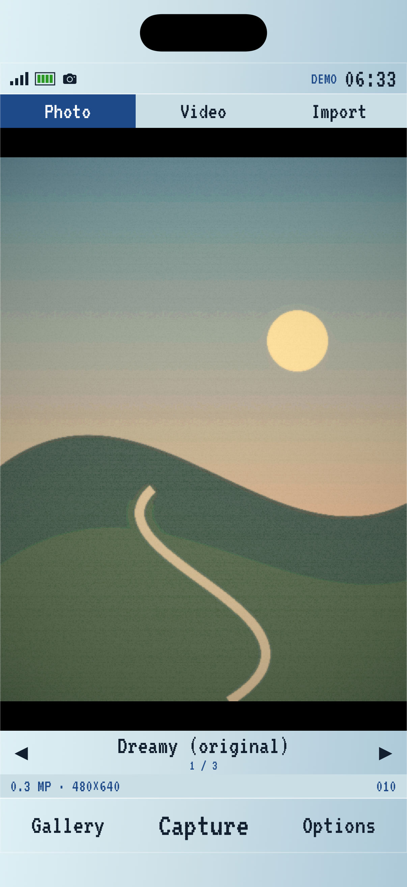

# Pocket03

A native iPhone camera for small, imperfect memories. SwiftUI + AVFoundation + Core Image. iOS 17+, no external dependencies, accounts, analytics or network services.



## Features

- A Series 40 style interface with pixel type, pale blue status/menu bars and **Gallery / Capture / Options** soft keys.
- Three camera looks: **Dreamy (original)**, **Nokia 2630 (2007)** and **Siemens CX70 (2004)**. These are new approximations, not the original app's protected formulas.
- Visible **Photo / Video / Import** workflow tabs. All three looks work with photos, recordings, imported photos and imported clips.
- Portrait 480 × 640 output; adjustable strength, highlight bloom, posterization, grain, banding and vignette. The selected look and strength persist.
- Front/back camera, torch and 1–4× zoom in Options → Settings (hardware permitting).
- Photo imports preview before saving, and can switch looks and effect strength. Import accepts videos too, with processing progress and cancellation. Choose the look before opening a video; its processed copy is saved to the gallery.
- Filtered **silent** H.264 movies for both recording and imported clips. Audio is intentionally absent and labeled in the interface.
- A persistent phone-style gallery, native sharing and explicit save to Photos. Previous gallery entries remain readable.
- A labeled generated landscape on the simulator; the physical iPhone uses its camera.

## Run

Open `Pocket03.xcodeproj` in Xcode, choose an iPhone simulator and Run. The project is checked in; XcodeGen is needed only after changing `project.yml`.

For a physical iPhone, choose your device and set your Apple development team in **Signing & Capabilities**. If necessary, change `studio.pocket03.camera` to a unique bundle ID. Enable Developer Mode on the phone and Run. No team or signing identity has been configured by this project.

```sh
# Regenerate only if changing project.yml
xcodegen generate
# Simulator build
xcodebuild -project Pocket03.xcodeproj -scheme Pocket03 \
  -destination 'platform=iOS Simulator,name=iPhone 17 Pro' \
  -derivedDataPath build CODE_SIGNING_ALLOWED=NO build
# Unit/integration and UI tests
xcodebuild -project Pocket03.xcodeproj -scheme Pocket03 \
  -destination 'platform=iOS Simulator,name=iPhone 17 Pro' \
  -derivedDataPath build CODE_SIGNING_ALLOWED=NO test
```

## Reverse engineering boundary

See [docs/reconstruction.md](docs/reconstruction.md). This is a new implementation informed by static observations from 0.3MP Camera Android 1.5.12, not recovered original source or an exact reproduction of its protected filter. No original brand artwork, model, native libraries or GLSL snippets are bundled.

## Validation

Eleven unit and integration tests and two end-to-end UI tests pass on the simulator. They cover all treatment dimensions, zero-strength color preservation, bounded grain, EXIF rotation, photo persistence, corrupt-index protection, storage-failure rollback, portrait silent-video output, imported-video frame preservation across all three looks, import cancellation with temporary-file cleanup, and the photo → gallery → video → relaunch UI flow. Physical camera exposure, front-camera mirroring, torch, on-device performance, Photos permissions and external sharing need an actual iPhone check. Photo picker interaction and physical permission prompts have separate manual validation boundaries; see `docs/validation.md`. App Store distribution is not configured.

## Typography

VT323 © 2011 The VT323 Project Authors (Peter Hull), distributed under the SIL Open Font License 1.1. The font and its full license are included in `Pocket03/Fonts/`. No font download is needed at runtime.
